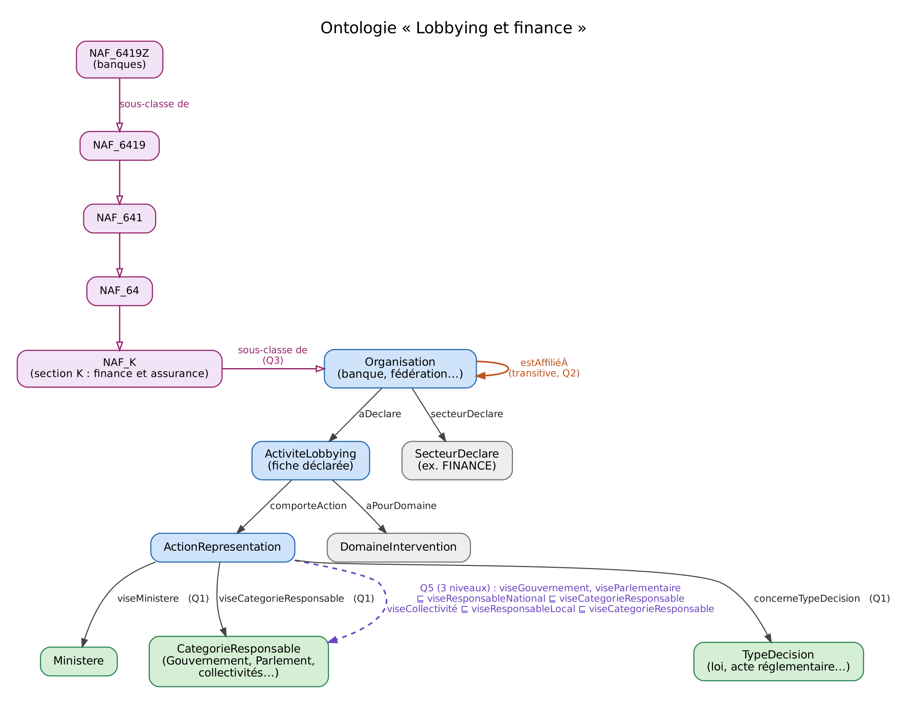

# Lobbying et finance : qui cherche à influencer les décisions publiques ?

*Knowledge graph of financial-sector lobbying in France, built from open data (HATVP register, Sirene, NAF, Wikidata) with RDF, OWL and SPARQL.*

Projet de Représentation de Connaissances sur le Web (IUT d'Orsay, BUT3 Informatique, 2026-2027), par Nicolas LANGLOIS et Robin CANOVAS.

Quelles banques, assurances et fédérations financières déclarent faire du lobbying, auprès de quels ministères et de quels responsables publics, et sur quels types de décisions ? Le projet répond avec un graphe de connaissances interrogeable en SPARQL, puis avec une application web pensée pour un citoyen non spécialiste.



**In English.** The French HATVP register lists organisations that lobby public officials. We convert the finance-sector part (432 organisations, about 26 000 declared activities) to RDF with a replayable Python script, model it with an OWL ontology (multi-level class and property hierarchies, a transitive affiliation property, a NAF activity-code chain), and use an OWL2-RL reasoner in GraphDB so that questions such as "which federations represent this bank, directly or indirectly?" are only fully answered thanks to inference. The data is declarative: the graph shows who declared what, not actual influence.

- Lien du dépôt de l'application web : à compléter
- Adresse publique du site : à compléter

## Avancement

| Étape | État |
|---|---|
| Jalon 1 : fiche projet | rendue (`docs/fiche-projet-jalon1.pdf`) |
| Jalon 2 : ontologie, conversion RDF, GraphDB, requêtes (a) et (b) | en cours |
| Jalon 3 : Wikidata, requête (c) | à venir |
| Application web | à venir |

Jalon 2 : ontologie (`ontologie.ttl`), conversion HATVP faite, requêtes Q1, Q2, Q3 et Q5 écrites et testées sur des instances de test. Reste : conversion Sirene et NAF, import dans GraphDB, vérification des inférences sur le graphe complet.

## Contenu du dépôt

| Chemin | Rôle |
|---|---|
| `ontologie.ttl` | ontologie (classes, propriétés, libellés `@fr` et `@en`) |
| `conversion/convertir_hatvp_finance.py` | script Python (rdflib) : JSON HATVP vers RDF/Turtle |
| `requetes/` | requêtes SPARQL `.rq` commentées, une par question de compétence |
| `tests/` | instances de test et vérification des inférences (HermiT, OWL-RL) |
| `data/` | description des sources (les fichiers bruts ne sont pas versionnés) |
| `docs/` | fiche projet du jalon 1, schéma de l'ontologie |

## Questions de compétence

| N° | Question | Type | Requête |
|---|---|---|---|
| Q1 | Quels ministères, catégories de responsables et types de décisions une banque a-t-elle visés ? | (a) | `requetes/q1_ministeres_categories_decisions.rq` |
| Q2 | Par quelles fédérations, directes ou indirectes, une banque est-elle représentée ? | (b) | `requetes/q2_federations_directes_indirectes.rq` |
| Q3 | Quelles organisations relèvent de la finance (section K de la NAF) ? | (b) | `requetes/q3_organisations_finance.rq` |
| Q4 | Parmi les organisations qui s'adressent à un ministère, lesquelles sont les plus grandes et les plus anciennes ? | (c) | à venir (Wikidata) |
| Q5 | Responsables nationaux ou locaux, selon le type de décision ? | (b) | `requetes/q5_nationaux_ou_locaux.rq` |

## Installer et lancer

Prérequis : Python 3.10 ou plus, Java (uniquement pour le raisonneur HermiT des tests).

```bash
python -m venv .venv
source .venv/bin/activate        # Windows : .venv\Scripts\activate
pip install -r requirements.txt
```

1. Télécharger le JSON HATVP dans `data/raw/` (voir `data/README.md`).
2. Convertir (environ 1 minute, 397 000 triplets) :
   ```bash
   python conversion/convertir_hatvp_finance.py data/raw/agora_repertoire_opendata.json --sortie out/graphe-hatvp-finance.ttl
   ```
   Options : `--annees 2024 2025` pour restreindre les exercices, `--max-organisations 60` pour un essai rapide.
3. Vérifier l'ontologie et les inférences sur les instances de test :
   ```bash
   python tests/verifier_inferences.py
   python tests/tester_requetes.py
   ```

## Reproduire le dépôt GraphDB

1. Installer GraphDB (https://graphdb.ontotext.com/) et ouvrir le Workbench.
2. Setup > Repositories > Create new repository > GraphDB repository, ruleset **OWL2-RL**.
3. Import > Upload RDF files : importer `ontologie.ttl`, puis `out/graphe-hatvp-finance.ttl`.
4. SPARQL : exécuter les requêtes du dossier `requetes/`. Pour voir uniquement les triplets déclarés (sans inférence), ajouter `FROM <http://www.ontotext.com/explicit>`.

## Sources et licences

- Répertoire des représentants d'intérêts, HATVP, Licence Ouverte (Etalab) : https://www.data.gouv.fr/datasets/repertoire-des-representants-dinterets
- Base Sirene, INSEE, Licence Ouverte 2.0 : https://www.data.gouv.fr/datasets/base-sirene-des-entreprises-et-de-leurs-etablissements-siren-siret
- NAF rév. 2, INSEE, Licence Ouverte 2.0 : https://insee.fr/fr/information/2120875
- Wikidata (identifiants SIREN [P1616](https://www.wikidata.org/wiki/Property:P1616), RNA [P3918](https://www.wikidata.org/wiki/Property:P3918) ; effectif [P1128](https://www.wikidata.org/wiki/Property:P1128), date de création [P571](https://www.wikidata.org/wiki/Property:P571), logo [P154](https://www.wikidata.org/wiki/Property:P154)), CC0 : https://www.wikidata.org
- Bilan 2023 du répertoire (HATVP) : https://www.hatvp.fr/wordpress/wp-content/uploads/2024/07/HATVP_BILAN_RRI-2023_VF.pdf

Les données du répertoire sont déclaratives : le graphe montre qui a déclaré quoi, sans mesurer l'influence réelle ni qualifier une irrégularité.

## Licence

Code sous licence MIT (voir `LICENSE`). Les données restent soumises à leurs licences d'origine, listées ci-dessus.
